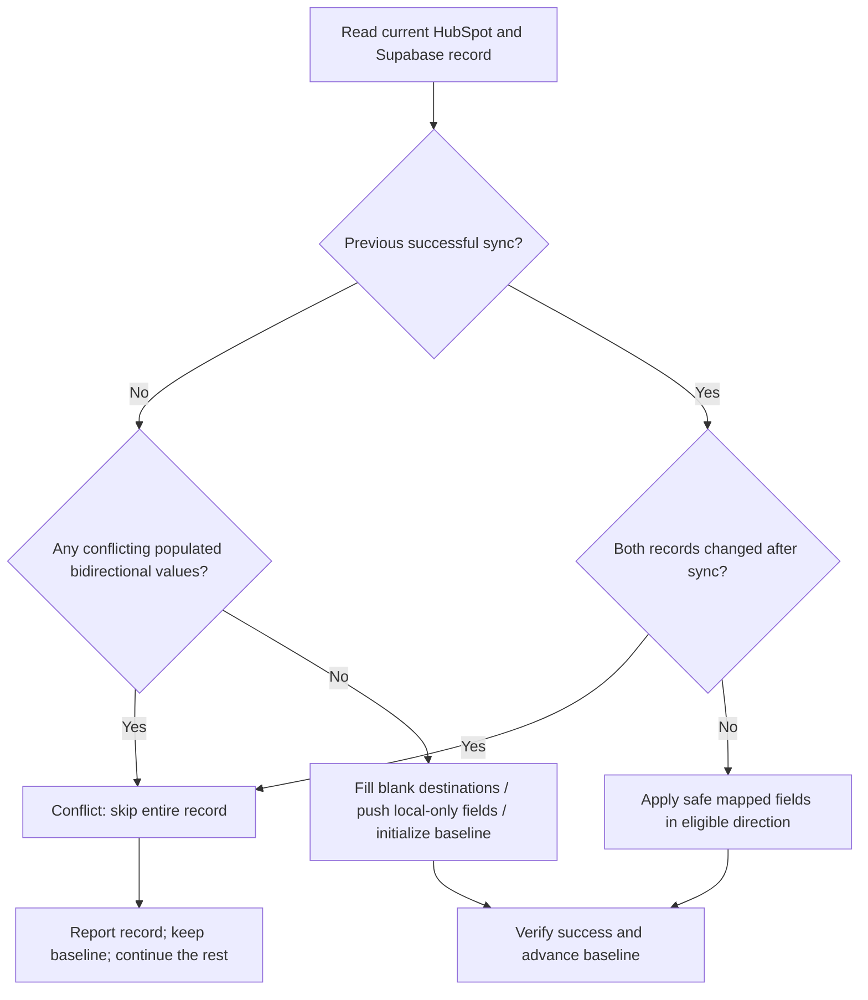
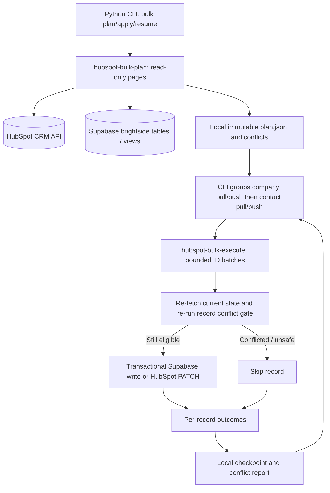

# Manual bulk-only HubSpot ↔ Supabase sync (Issue #1)

**Not deployed.** This feature branch changes source code and proposes a migration; it does not alter the running server or production CRM. Review, test and explicitly approve any migration/deployment separately.

## Scope and ownership

- One supported CLI workflow: **full bulk sweep** using `hubspot-sync plan`, `hubspot-sync apply`, `hubspot-sync resume`. No single-ID targeting interface.
- Pull = HubSpot → Supabase. Push = Supabase → HubSpot. Company operations run before contact operations; within an entity, pull before push.
- The Edge functions receive bounded arrays of IDs exclusively as internal transport for an all-record plan. They hold **no server-side job, plan, cursor or lock state**.
- Unmatched HubSpot companies/contacts may be **created in Supabase** after deterministic matching and company-association validation. Unmatched Supabase objects are **not** created in HubSpot.
- Never clear populated values from an empty source, rewrite consent/legal-basis/lifecycle/owner fields, infer contact-company associations, or write ambiguous matches/child rows.

## Record-level conflict rule

The tables `brightside.companies` and `brightside.contacts` already have `hubspot_export_updated_at`: the last relevant Supabase data change, including related child table changes. **Migration required before calling new endpoints**: `migrations/20261013_bulk_sync_baseline.sql` adds a nullable `hubspot_last_synced_at` to each parent table and updates `_hubspot_export_stamp_record()` to exclude the baseline-only column.

HubSpot CRM `updatedAt` is the **whole-record** modified timestamp. Compare both against the same record's stored `hubspot_last_synced_at`:



**Accepted limitation:** If HubSpot phone changes Tuesday and Supabase company name changes Wednesday after a Monday successful sync, **skip the whole company**. This intentionally cannot tell which column actually changed. No per-column histories, source-of-truth inference, or field-level merge logic are added. HubSpot updates to unrelated CRM properties can cause conservative false-positive conflicts.

**NULL bootstrap**: matching populated values and safe one-sided blank fills may be reconciled and stamped. When both sides have different populated bidirectional values without a known baseline, report `no_sync_baseline_conflict` and **do not write that record**. Never bulk-initialize all baselines to `now()` without reconciliation.

`--force=pull` or `--force=push` explicitly queues conflicting records in **one direction only**. Forced execution is still bounded, re-fetches current data, and does not resolve conflicts; it overwrites eligible mapped destination fields by the selected source direction. Force cannot fabricate a HubSpot match for an unmatched Supabase record. The normal plan/apply path never acts on conflicted records.

## Architecture



## Edge contracts

Planner (read-only), page through **both** HubSpot and Supabase inventories for companies then contacts:

```json
{"objectType":"companies","source":"hubspot","limit":50,"cursor":null}
```

HubSpot pages return `records` with remote/local IDs, status, any `operations` (only entity, ID, direction), conflict reason and `nextCursor`. Supabase pages return local IDs (`limit` max 500) for outbound-unmatched reporting. Python CLI checks cross-page duplicate HubSpot↔Supabase matches and duplicate new natural keys before finalizing a complete plan.

Executor (internal, manual only):

```json
{"objectType":"companies","direction":"pull","ids":["123456"],"confirm":"APPLY"}
```

For a forced batch: `"force":true,"confirm":"FORCE_PULL"` (or `FORCE_PUSH`). Default CLI batch size is **25** (conservative initial value), configurable up to **100**. This is independent of HubSpot listing pages (50). No caller-provided patch data; re-evaluate matching, record conflict and field values at execution time. Results report `created`, `applied`, `already_synchronized`, `conflict`, `skipped`, or `failed` **per ID**. Failures do not prevent unrelated records from being processed.

## CLI usage

```sh
./bin/hubspot-sync plan --env-file ../supabase/.env
./bin/hubspot-sync apply --env-file ../supabase/.env
./bin/hubspot-sync resume --env-file ../supabase/.env

# Deliberately overwrite only records recorded as conflicts, in one direction:
./bin/hubspot-sync apply --force=pull --checkpoint-file checkpoint-forced-pull.json --env-file ../supabase/.env
```

All apply operations require interactive `APPLY` confirmation (or `--yes` explicitly). `plan.json` is immutable, `checkpoint.json` tracks completed internal ID worklist entries, and `sync-report.json` includes the full conflict list and outcome summary. A plan SHA-256 digest prevents accidental editing; `resume` requires the matching plan and checkpoint. A lost/ambiguous batch response is retried safely because record eligibility is recalculated on every Edge invocation. Use new checkpoint filenames for a different plan or `--force` direction.

Secrets: `SUPABASE_SECRET_KEY` (`sb_secret_...`) is supplied via process environment or explicit `--env-file`, sent **only** in the HTTPS `apikey` header. The Edge Function fetches `HUBSPOT_ACCESS_TOKEN` from Supabase Vault. Never put secrets in CLI arguments, URLs or plan/checkpoint files.

## Deployment review checklist

1. Review and approve the migration separately; **do not initialize timestamps for historical records**. Confirm existing `_hubspot_export_stamp_record` is unchanged except excluding the baseline column.
2. Add **both** new Edge function directories to the self-hosted `functions` service's sibling bind mounts, without changing Supabase's upstream function router/base mount. Both import `hubspot-webhook/lib`, so keep its mount.
3. Ensure `SUPABASE_DB_URL`, Vault `HUBSPOT_ACCESS_TOKEN` and `SUPABASE_SECRET_KEYS` are available, and the standard self-hosted opaque-key routing behavior matches current legacy endpoints.
4. Run `deno task check && deno test tests/ && python3 -m unittest discover -s tests -p test_cli.py -v` on a development machine. These tests do not establish production compatibility.
5. First run `plan` only. Review conflicts and payload sizes. Test non-conflicting and NULL-baseline records in a nonproduction copy before full apply.
6. Start at `--batch-size 25` and benchmark 50/100 carefully; initial runtime capacity is **unproven**. No cron/webhooks or autonomous execution.

## Known limits

- Record-level timestamps are intentionally coarse; changing unrelated CRM fields can trigger conflict. Concurrent cross-system writes cannot be made atomic; the implementation revalidates current source state and uses transactional local writes, but has a short remote race window.
- Outbound updates require exact HubSpot `supabase_company_id` / `supabase_contact_id` linkage. Inbound matches by unique domain/email can create/update Supabase records without writing missing external-ID links back to HubSpot. Such unlinked records are reported as outbound-unavailable and require separate identity remediation.
- Normalized child rows must be unambiguous; a record with ambiguous export values is skipped. Existing legacy five-record endpoints remain in the repository but **are not used or advertised by this new bulk-only CLI**.
- Local `checkpoint.json` and `plan.json` are operational artifacts; they are not a centralized distributed lock. Only one trusted operator should execute a given bulk plan at a time.
